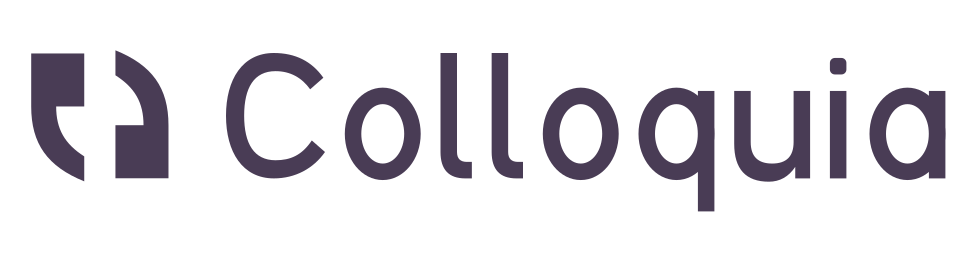

<h1>
  <picture>
    <source media="(prefers-color-scheme: dark)" srcset="packaging/logo-blanco.svg">
    
  </picture>
</h1>

Grabación y transcripción **local** de sesiones largas (una hora o más) entre psicólogo y paciente.

Pulsas **Grabar**, haces la sesión y pulsas **Detener**. Colloquia guarda en la carpeta que elijas:

- `sesion.mp3`: la grabación completa (64 kbps mono, unos 30 MB por hora).
- `transcripcion.txt`: la transcripción **literal**, con marcas de tiempo, separando las dos voces (Psicólogo/Paciente) y marcando silencios, pausas y palabras dudosas.

Nada sale del ordenador: no usa servicios en la nube ni telemetría. Los modelos se descargan una sola vez y después funciona sin conexión.

## Transcripción literal

Colloquia está pensada para sesiones en las que importa **cómo** se habla, no solo qué se dice; por ejemplo, con niños que se equivocan al hablar. Por eso:

- Conserva las muletillas (*eh*, *mmm*), las repeticiones (*yo… yo fui*), los cortes (*Ma… mamá*) y las palabras mal pronunciadas que reconoce (*pakue*, *pelo* por *perro*).
- Mide los silencios directamente sobre el audio y los marca:
  ```
  [00:00:03] (silencio 1,7 s)
  [00:00:05] Paciente: Eh... (pausa 1,6 s) yo... yo fui al... al Pacue... mmm[?]... (pausa 2,2 s) con mi mamá.
  ```
  - `(pausa X s)`: silencio dentro de una intervención.
  - `(silencio X s)` en su propia línea: silencio entre intervenciones, es decir, el tiempo de respuesta.
  - El umbral se configura en Ajustes (1, 1,5, 2 o 3 s).
- Marca con `palabra[?]` las palabras que el modelo reconoce con poca seguridad. Suelen ser palabras mal pronunciadas o poco claras, y conviene escucharlas en el MP3.

> **Limitación importante:** Whisper, el modelo de transcripción, se entrenó para producir texto legible. Aunque Colloquia lo fuerza a transcribir de forma literal, a veces sigue «corrigiendo» una palabra mal pronunciada por la correcta (por ejemplo *gande* → *grande*). La transcripción sirve de guía y el MP3 es la referencia: para un análisis fino del habla, revisa los fragmentos marcados con `[?]` escuchando el audio.

## Identificación de las voces

- Se detectan automáticamente dos voces.
- La de quien habla primero se asigna al psicólogo.
- Al terminar, Colloquia muestra una frase de cada voz y un botón **Intercambiar** por si lo asignó al revés.
- Los nombres de los roles se cambian en Ajustes.

## Instalación

Descarga el instalador de tu sistema desde la página de *Releases* del repositorio. Windows y macOS incluyen Python; el instalador nativo de Linux usa el de tu distribución.

### Windows

Descarga `Colloquia-Windows-Setup.exe`. Sirve para cualquier equipo: si hay una GPU NVIDIA la usa para transcribir mucho más rápido y, si no, funciona con la CPU. Si el equipo tiene una NVIDIA, el instalador pregunta si quieres descargar el soporte de GPU (unos 1,3 GB). Si aceptas, se descarga en segundo plano la primera vez que abres Colloquia y, hasta que termina, usa la CPU. Para cambiar de opinión, vuelve a ejecutar el instalador.

El instalador:
- no pide permisos de administrador; instala en `%LOCALAPPDATA%\Programs\Colloquia`;
- crea un acceso en el menú Inicio y, si lo marcas, en el escritorio.

Como el instalador no está firmado, Windows SmartScreen puede avisar: pulsa **Más información** → **Ejecutar de todas formas**.

### macOS (Apple Silicon)

1. Abre `Colloquia-…-macos-arm64.dmg` y arrastra **Colloquia** a **Aplicaciones**.
2. La app no está firmada por Apple, así que la primera vez macOS la bloquea. Ve a **Ajustes del Sistema → Privacidad y seguridad** y pulsa **Abrir igualmente**.
3. macOS pedirá permiso para usar el micrófono: concédelo.

### Linux

La opción recomendada es la **instalación nativa desde terminal**: usa GTK y
WebKit de tu distribución, y evita mezclar las bibliotecas del AppImage con
los controladores gráficos del equipo.

Descarga `Colloquia-Linux-Source.tar.gz`, abre una terminal en la carpeta de
descarga y ejecuta:

```bash
mkdir -p "$HOME/.local/share/colloquia"
tar -xzf Colloquia-Linux-Source.tar.gz --strip-components=1 -C "$HOME/.local/share/colloquia"
cd "$HOME/.local/share/colloquia"
bash instalar.sh
```

El instalador detecta los gestores `apt` (Linux Mint, Ubuntu y Debian), `dnf`
(Fedora) y `pacman` (Arch y derivadas). Pide `sudo` para las dependencias del
sistema; la aplicación se instala para tu usuario. Necesita Python 3.10 o
superior y acceso a internet durante la instalación.

Al terminar, abre **Colloquia** desde el menú de aplicaciones o ejecuta
`~/.local/bin/colloquia`. El instalador comprueba los módulos de audio y
transcripción y, si hay una sesión gráfica, abre una ventana oculta para
comprobar que WebKit carga y ejecuta JavaScript. Si falla, se detiene y muestra
el error en la terminal. Sin sesión gráfica, esa comprobación queda pendiente.

No muevas la carpeta de instalación: contiene la app y su entorno `.venv`.
Para actualizar, extrae el nuevo paquete en la misma carpeta y vuelve a ejecutar
`bash instalar.sh`. Si la distribución ha cambiado de versión de Python,
renombra primero `.venv` para que se cree un entorno nuevo.

También puedes instalar desde una copia del repositorio con `bash instalar.sh`.
Para instalar sin abrir la app al terminar, añade `--no-launch`.
Si el administrador ya ha instalado las dependencias, añade `--skip-system-deps`.
Estas son las dependencias por distribución:

```bash
# Linux Mint / Ubuntu / Debian
sudo apt-get install python3 python3-venv python3-gi python3-gi-cairo gir1.2-gtk-3.0 gir1.2-webkit2-4.1 libportaudio2 xdg-utils

# Fedora
sudo dnf install python3 python3-pip python3-gobject gobject-introspection gtk3 webkit2gtk4.1 portaudio xdg-utils

# Arch
sudo pacman -S --needed python python-pip python-gobject gtk3 webkit2gtk-4.1 portaudio xdg-utils
```

En otras distribuciones, instala los paquetes equivalentes y usa
`bash instalar.sh --skip-system-deps`. La compatibilidad depende de las
versiones de Python y de las dependencias disponibles; no se garantiza para
todas las distribuciones. El flujo `linux-native.yml` prueba instalación y
WebKit en Ubuntu 22.04/24.04, y dependencias e instalación en Fedora y Arch.

La instalación nativa usa la CPU para transcribir, salvo que hayas configurado
por separado un backend de GPU compatible.

**Paquetes portables alternativos:**

- `Colloquia-…-linux-x86_64.AppImage`: dale permiso de ejecución (`chmod +x`) y ábrelo.
- `Colloquia-…-linux-x86_64.tar.gz`: descomprímelo y ejecuta `Colloquia/Colloquia`.

Si no detecta el micrófono, instala PortAudio desde tu distribución (por ejemplo, `sudo apt install libportaudio2`).

Si al hacer doble clic no se abre, ejecútalo desde una terminal para ver el error.
Si el error menciona FUSE, puedes abrirlo sin FUSE con
`./Colloquia-Linux.AppImage --appimage-extract-and-run` (ajusta el nombre al del archivo descargado).

En la versión 1.3.0, Linux Mint puede mostrar errores de Mesa, `GLIBCXX` o
«Compositor returned null texture» por incompatibilidades entre las bibliotecas
del paquete y los controladores del sistema. Para probar el arranque con Qt y
sin aceleración gráfica de la ventana:

```bash
PYWEBVIEW_GUI=qt QT_XCB_GL_INTEGRATION=none QTWEBENGINE_CHROMIUM_FLAGS="--disable-gpu" GIO_USE_VFS=local ./Colloquia-Linux.AppImage --appimage-extract-and-run
```

El código actual aplica este modo de compatibilidad a los paquetes portables de Linux.
Este cambio requiere recompilar la aplicación para incluirlo en el AppImage;
no modifica los archivos ya publicados de la versión 1.3.0.

### Desde el código fuente

Necesitas Python 3.10 o superior.

- **Windows:** doble clic en `instalar.bat`. Si hay una GPU NVIDIA, instala el soporte CUDA, y crea accesos directos en el menú Inicio y en el escritorio.
- **macOS:** doble clic en `instalar.command`. Crea `~/Applications/Colloquia.app`.
- **Linux:** ejecuta el instalador nativo, que instala las dependencias y crea el acceso en el menú de aplicaciones.
  ```bash
  bash instalar.sh
  ```

### Modelos y equipos sin conexión

La primera vez se descargan unos 1,7 GB con el modelo Turbo:
- el modelo de transcripción, desde Hugging Face, en `~/.cache/huggingface`;
- los modelos de voces, desde GitHub, en la carpeta de configuración de Colloquia.

Para instalar en un equipo sin internet, copia los modelos en una carpeta `models/` junto a la aplicación: junto a `Colloquia.exe`, `Colloquia.app` o el `.AppImage` en las versiones instaladas, o junto a `colloquia.py` si usas el código fuente.

```
models/
  faster-whisper-large-v3-turbo/   (model.bin, config.json, tokenizer.json…)
  sherpa-onnx-pyannote-segmentation-3-0/model.onnx
  3dspeaker_speech_campplus_sv_zh_en_16k-common_advanced.onnx
```

## Tiempo de procesado

Colloquia transcribe **mientras grabas**, en fragmentos de 30 a 90 segundos que corta en los silencios, y va guardando también el MP3. Al pulsar **Detener** solo queda el último fragmento y la identificación de las voces, que tarda unos 3–10 minutos por hora de sesión según el equipo. La pantalla de grabación muestra hasta qué minuto lleva la transcripción.

En un portátil antiguo sin gráfica dedicada, el modelo Turbo transcribe a una velocidad parecida a la de la conversación. Si el equipo no llega, al terminar transcribe lo que quede pendiente y avisa de que el modelo Small (Ajustes) es casi el doble de rápido, a cambio de algo menos de precisión.

La transcripción va en un proceso aparte, con prioridad baja para no entorpecer la grabación. Si la app se cierra en mitad de una sesión, al recuperarla aprovecha lo que ya estaba transcrito.

Al terminar, la transcripción y la identificación de voces se hacen en paralelo. Con GPU NVIDIA y el soporte CUDA descargado se usa faster-whisper; con otras GPU (o una NVIDIA sin CUDA) se usa whisper.cpp con Vulkan en Windows y Linux, o Metal en Mac. Si no hay GPU compatible, o whisper.cpp falla, se transcribe con la CPU.

## Seguridad de la grabación

- El audio se escribe en disco de forma continua. Si el ordenador se apaga o la app se cierra en mitad de una sesión, al volver a abrirla aparecerá «Hay una grabación sin procesar» con un botón para procesarla.
- Mientras graba o procesa, el equipo no entra en suspensión.
- Si el micrófono deja de captar sonido durante 30 s, la app avisa.

## Privacidad

- Las grabaciones de sesiones clínicas son datos de salud. Pide el consentimiento informado del paciente o de sus tutores antes de grabar.
- Los archivos se guardan sin cifrar en la carpeta elegida. Usa un disco cifrado (BitLocker, FileVault, LUKS) o una carpeta protegida.

## Procesar un audio existente

Con la versión instalada:
- Windows: `colloquia-cli.exe grabacion.mp3 carpeta_salida`, desde la carpeta de instalación.
- macOS: `/Applications/Colloquia.app/Contents/MacOS/Colloquia grabacion.mp3 carpeta_salida`.
- Linux (instalación nativa): `~/.local/bin/colloquia grabacion.mp3 carpeta_salida`.
- Linux (AppImage): `./Colloquia-…-linux-x86_64.AppImage grabacion.mp3 carpeta_salida`.

Desde el código fuente:

```bash
.venv/bin/python pipeline.py grabacion.mp3 carpeta_salida
```

En Windows, usa `.venv\Scripts\python.exe`.

## Compilar los instaladores

Los instaladores se generan con PyInstaller a partir de `packaging/colloquia.spec`. Desde el entorno con las dependencias instaladas:

```bash
pip install pyinstaller pillow
```

```bash
pyinstaller --noconfirm packaging/colloquia.spec
```

- El resultado queda en `dist/`: `Colloquia/` en Windows y Linux, `Colloquia.app` en macOS.
- Las DLL de CUDA (cuBLAS y cuDNN) no van en el paquete: si la aplicación detecta una GPU NVIDIA, las descarga de PyPI en `%LOCALAPPDATA%\Colloquia\cuda`.
- Para incluir whisper.cpp, define `WHISPER_CLI` con la ruta a `whisper-cli` antes de ejecutar PyInstaller; la CI lo compila con Vulkan (Windows y Linux) o Metal (macOS). Sin él, Colloquia usa solo faster-whisper. Sus modelos (GGML, unos 575 MB el Turbo) se descargan aparte la primera vez.
- El instalador de Windows se crea con Inno Setup: `iscc packaging\colloquia.iss`.
- El flujo `.github/workflows/build.yml` compila Windows, macOS y Linux, e incluye `Colloquia-Linux-Source.tar.gz` con el instalador nativo y el código necesario. Se ejecuta a mano o al subir una etiqueta `v*`; en ese caso crea un borrador de *release* con los instaladores.

## Configuración

`config.json` está en:
- `%APPDATA%\Colloquia` en Windows;
- `~/Library/Application Support/Colloquia` en macOS;
- `~/.config/colloquia` en Linux.

En esa misma carpeta está el registro de errores, `colloquia.log`.
